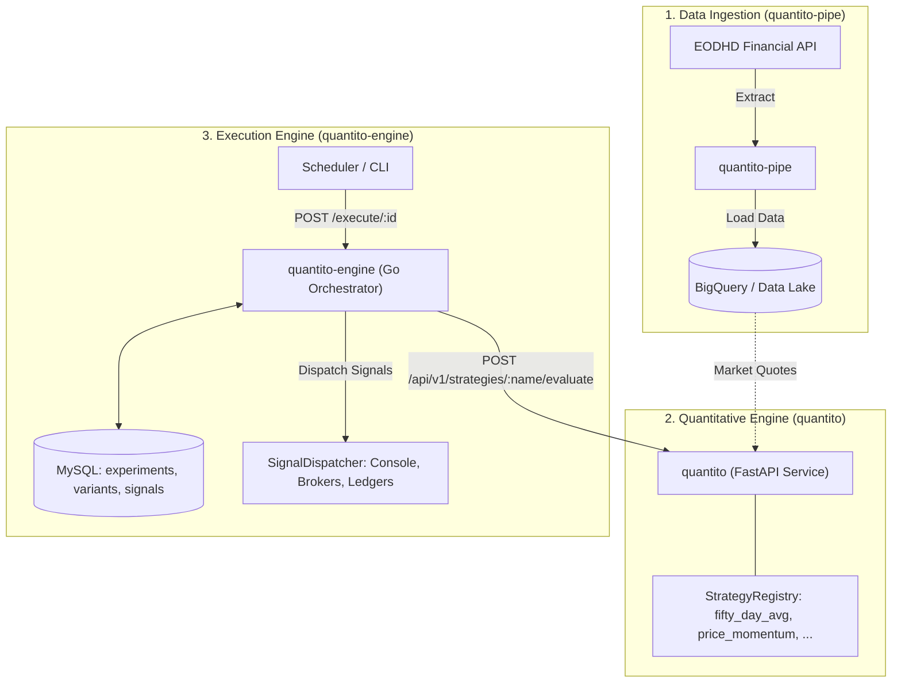

# Quantito Strategy Engine (`quantito`)

**Quantito** is the quantitative strategy evaluation and signal generation service of the **Quantito Financial Platform**. Built with Python 3.12+ and FastAPI, it provides a high-performance HTTP API for evaluating quantitative trading algorithms on market data.

---

## 1. Role in the Quantito Ecosystem

The **Quantito Platform** is split into three decoupled, specialized services:



| Service | Technology | Role |
| :--- | :--- | :--- |
| **`quantito-pipe`** | Python / Cloud Run Job | Ingests market quotes (EOD, Delayed, Real-time) from EODHD into BigQuery. |
| **`quantito`** *(this repo)* | Python 3.12 / FastAPI | Pure quantitative strategy evaluation service (`fifty_day_avg`, `price_momentum`). |
| **`quantito-engine`** | Go / Echo / MySQL | Experiment orchestrator, parallel contraposition, concurrency locks, signal ledger, and dispatcher. |

---

## 2. Features

- **Decoupled Strategy Computation**: Stateless functional computation — receives quotes and strategy parameters, outputs standardized trading signals.
- **Dynamic Strategy Registry**: Extensible pattern (`StrategyRegistry`) allowing hot-discovery and execution of pluggable algorithms.
- **RESTful API**: Fast and fully-typed HTTP endpoints powered by FastAPI and Pydantic v2.
- **Packaged `src-layout`**: Packaged as `src/quantito` conforming to modern Python packaging standards (PEP 518/621).
- **Strict Quality**: 100% unit test coverage, Ruff linting, and automated Docker smoke tests.

---

## 3. Registered Strategies

| Strategy Name | Class | Description |
| :--- | :--- | :--- |
| **`fifty_day_avg`** | `FiftyDayAverageStrategy` | Compares current price against its 50-day moving average. Emits `BUY` or `SELL` when exceeding `threshold_pct`. |
| **`price_momentum`** | `PriceMomentumStrategy` | Evaluates percentage price change over a recent window against buy/sell thresholds. |

---

## 4. API Endpoints

### Healthcheck
```http
GET /health
GET /api/v1/health
```
Response:
```json
{
  "status": "ok",
  "timestamp": "2026-10-10T10:00:00.000000+00:00"
}
```

### List Available Strategies
```http
GET /api/v1/strategies
```
Response:
```json
{
  "strategies": ["fifty_day_avg", "price_momentum"]
}
```

### Evaluate Strategy
```http
POST /api/v1/strategies/{strategy_name}/evaluate
Content-Type: application/json
```
Request Body:
```json
{
  "symbol": "AAPL.US",
  "params": {
    "threshold_pct": 2.0,
    "signal_on": "both"
  },
  "market_data": [
    {
      "symbol": "AAPL.US",
      "close": 105.5,
      "fiftyDayAveragePrice": 100.0
    }
  ]
}
```
Response (`200 OK`):
```json
{
  "strategy": "fifty_day_avg",
  "signals": [
    {
      "symbol": "AAPL.US",
      "signal_type": "BUY",
      "price": 105.5,
      "timestamp": "2026-10-10T10:00:00.000000+00:00",
      "strategy_name": "fifty_day_avg",
      "confidence": 0.55,
      "metadata": {
        "fiftyDayAveragePrice": 100.0,
        "diff_pct": 5.5,
        "threshold_pct": 2.0
      }
    }
  ]
}
```

---

## 5. Local Development & Testing

```bash
# 1. Create and activate virtual environment
python3 -m venv .venv
source .venv/bin/activate

# 2. Install package in editable mode with development dependencies
pip install -e ".[dev]"

# 3. Code formatting and linting
ruff check . && ruff format --check .

# 4. Run test suite
python -m unittest discover tests

# 5. Launch the Strategy Server (defaults to port 8080 or pass --port)
python main.py --host 0.0.0.0 --port 8081
```

---

## 6. Docker Execution

```bash
# Build Docker image
docker build -t quantito:latest .

# Run container (mapping host port 8081 to container port 8080)
docker run -p 8081:8080 quantito:latest
```
